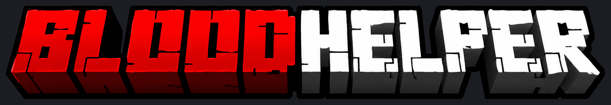

# BLOODHELPER 1.1.0+1.21.11 — Minecraft 1.21.11

BLOODHELPER — клиентский визуальный мод Fabric с восемью модулями. К кулдаунам
предметов, PvP-таймеру и музыкальному Dynamic Island добавлены Notifications,
Item Counter, Armor HUD, Performance и Session Stats. Меню сохраняет компоновку
Expensive 4.0: боковые категории, две колонки карточек и настройки внутри каждой
карточки. Все текстовые поля меню и HUD используют собственный рендерер OTF.

Версия **1.1.0+1.21.11**. Подробные результаты сборки, тестов и игровых
проверок: [docs/VERIFICATION_RU.md](docs/VERIFICATION_RU.md).



## Установка

Нужны **Minecraft Java 1.21.11**, **Java 21 или новее**, **Fabric Loader 0.18.6
или новее** и **Fabric API для 1.21.11**. При разработке используются Loader
0.19.5 и Fabric API 0.141.6+1.21.11.

Положи собранный `BloodHelper-1.1.0+1.21.11.jar` и Fabric API в папку `mods` выбранного
профиля Minecraft. Запусти этот профиль и нажми **правый Shift**. Серверная
установка для самого клиентского мода не требуется. Полная инструкция:
[docs/INSTALL_RU.md](docs/INSTALL_RU.md).

Эта сборка предназначена только для **1.21.11**. Исходный Changes for Cooldown,
Cloth Config и Mod Menu для работы BLOODHELPER не требуются. Если одновременно
оставить другой мод с таким же HUD, он будет выводить собственные индикаторы.

## Модули

| Модуль | Возможности |
| --- | --- |
| Cooldowns | Иконки, оставшееся время, названия, полосы прогресса, неизвестные группы, положение и масштаб. Источник — активные кулдауны игрока. |
| PvP Timer | Время выбранной серверной группы кулдауна, полоска прогресса и отдельное положение HUD. По умолчанию группа `minecraft:trident`. |
| Dynamic Island | Название трека, исполнитель, обложка, прогресс, управление воспроизведением, компактный вид и тексты песен. Источник музыки — медиасессия Windows. |
| Notifications | Короткие предупреждения о пересечении порогов прочности брони, количества выбранных предметов и оставшегося времени полезных эффектов. Звук по умолчанию выключен. |
| Item Counter | До восьми выбранных типов предметов из собственного инвентаря; готовые варианты предметов и Add held item. Подсчёт по registry ID. |
| Armor HUD | Четыре надетых элемента брони, оставшаяся прочность в процентах или единицах, полосы прочности и выделение низких значений. |
| Performance | Фактический FPS, измеренный интервал между кадрами и его график; ping, если клиент получил его. |
| Session Stats | FFA по двум форматам серверных сообщений: всего убийств и убийств с наградой. SMP / MEETUPS: убийства, смерти, K/D и серия по доступным клиенту событиям. |

**Отдельного Effects HUD нет.** Обычные индикаторы эффектов Minecraft остаются
без изменений; предупреждение об окончании полезного эффекта находится
в Notifications. Уже низкое значение при первом наблюдении не создаёт
уведомление, а постоянное нахождение ниже порога не повторяет его каждый кадр.

Item Counter считает **36 основных слотов, включая хотбар, и вторую руку один
раз**. Предмет в основной руке уже входит в хотбар. Контейнеры, предмет на
курсоре и надетая броня в сумму не входят. Кастомные предметы с одним базовым
registry ID объединяются независимо от имени и компонентов.

Session Stats по умолчанию работает в **FFA**. Сообщение о монетах за убийство
увеличивает **Total kills + Rewarded kills**, сообщение об отказе в монетах за этого игрока —
только **Total kills**. В FFA выводятся только два счётчика убийств и, при желании,
время; смерти, K/D и серия относятся к SMP / MEETUPS. Смена режима сбрасывает
сессию. Это вывод из полученных клиентом событий: отсутствующие или
нераспознанные сообщения не превращаются в предполагаемые убийства.
[Точные форматы, настройки и ограничения новых модулей](docs/MODULES_1_1_RU.md).

Новые модули используют данные, доступные клиенту, и не требуют изменения
сервера. Performance не измеряет серверный TPS.

**PvP-таймер показывает серверную группу кулдауна.** Значение `minecraft:trident`
имеет смысл таймера боя на сервере, использующем такую договорённость. Мод не
вычисляет начало боя по ударам или чату. На другом сервере обычная перезарядка
трезубца также может попасть в эту строку; группу можно изменить в настройках
модуля. При отключении PvP этот кулдаун остаётся в общем списке предметов.

Время перезарядки берётся из Minecraft и не изменяется клиентом. Пользовательские
предметы сопоставляются по фактической группе кулдауна предмета; если нужный
предмет отсутствует в инвентаре и реестре, доступен значок часов.

## Dynamic Island и тексты песен

Открой **правый Shift → Visuals → Dynamic Island**. Параметр **Lyrics**
расположен внутри карточки самого музыкального модуля:

- **Off** — музыка, обложка и управление без загрузки текста песни.
- **Island** — синхронизированная строка внутри Dynamic Island.
- **World (3D)** — строки перед игроком, закреплённые в мире при появлении.
- **Island + 3D** — оба способа одновременно.

Доступны динамическая анимация, появление по буквам, изменение масштаба, сдвиг
и плавное появление; цвет темы, градиент или белый цвет; разбиение длинных строк
и сдвиг синхронизации до ±5 секунд. Для текста в мире настраиваются число строк,
расстояние, разброс и вертикальная анимация. 3D-текст рисуется только локально
и перекрывается геометрией мира. Для 3D-текста сохранён отдельный путь отрисовки
Minecraft с кириллическим шрифтом на основе Inter. Текст внутри островка, как
и остальной HUD, использует новый собственный OTF-рендерер.

Текст запрашивается у **[LRCLIB](https://lrclib.net)**, когда музыкальный модуль
включён, выбран режим с текстом и плеер сообщил текущий трек. В запрос передаются
название, исполнитель и, если известна, длительность. Игровой чат, адрес сервера
и данные Minecraft-аккаунта в эти запросы не входят. Режим Off прекращает
запросы текста. Если синхронизированной версии песни нет, строка не выводится.

Музыка поддерживается на **Windows 10 1809+ / Windows 11** через штатную
медиасессию системы. Нужен проигрыватель, который её публикует. Сначала включи
трек в своём приложении; клиент подхватит выбранную Windows сессию. Обложка,
длительность, точность позиции и поддержка команд зависят от проигрывателя.

Чтобы нажимать кнопки прямо на островке в игре, **открой чат клавишей T** и
используй курсор. Эти же команды доступны в настройках Dynamic Island при
обнаруженной медиасессии. Компактный островок оставляет название, исполнителя
и обложку; строка текста, шкала и кнопки находятся в полном виде.

Внутри JAR находится небольшой мост Windows PowerShell, работающий в фоне.
Он не устанавливает пакеты и не меняет постоянную политику PowerShell. На Linux,
macOS и Java внутри WSL музыкальная интеграция недоступна, остальные элементы
клиента не требуют Windows. Подробности:
[docs/MEDIA_BACKEND_RU.md](docs/MEDIA_BACKEND_RU.md).

## Интерфейс и профили

- **Visuals** показывает восемь карточек в двух колонках; по умолчанию карточки
  свёрнуты. **Enable** включает модуль независимо от раскрытия карточки,
  заголовок раскрывает настройки внутри неё, **More settings** открывает
  дополнительные параметры там же. Названия модулей английские, описания
  по умолчанию русские.
- Область карточек прокручивается колесом мыши. Поиск понимает русские
  и английские названия модулей.
- **Appearance**: акцент, масштаб меню относительно экрана, уменьшение анимации,
  язык описаний, клавиша открытия, общие фон и тень текста HUD. Каждый новый
  модуль также имеет отдельные переключатели фона и тени; общие выключатели
  имеют приоритет.
- **HUD Editor**: перетаскивание блоков, колесо над блоком меняет его масштаб,
  `R` возвращает исходное расположение, `Esc` сохраняет и возвращает в меню.
  Все пять новых HUD поддерживают перемещение и масштаб 50–200%. Данные
  предпросмотра служат для настройки расположения и не пополняют статистику.
- **Profiles** сохраняют полный набор настроек. Загрузка применяет профиль сразу.
  Для удаления нажми кнопку повторно в течение пяти секунд.

Настройки записываются в `config/bloodhelper/client.json`, профили — в
`config/bloodhelper/profiles/` внутри папки выбранного профиля Minecraft.
Изменения переключателей сохраняются сразу, ползунков — при отпускании мыши.
Меню не ставит игровой мир на паузу.

Окно 800×500 в координатах дизайна подстраивается под разрешение; **Interface
scale** меняет размер относительно доступного экрана. Категории, названия
модулей и простые подписи остаются английскими. RU/EN переключает описания
и пояснения. Фон с узором, вкладки и часть иконок перенесены из опубликованных
исходников Expensive; фон и вкладки перекрашены под BLOODHELPER.

Текст меню, полей ввода и всех полей HUD, включая новые счётчики, подписи,
прочность, время, ping и уведомления, загружается из `sfpromedium.otf` и
`sfprosemibold.otf`. Собственный `CustomFont` рассчитывает ширину и рисует
глифы через атласы текстур: растеризация с антиалиасингом, усреднение покрытия
при уменьшении в четыре раза по каждой оси, линейная фильтрация. Minecraft
`Font`/`TextRenderer` в этом пути не используется. Курсор, выделение и обрезка
строк используют метрики того же шрифта. Подробности:
[docs/EXPENSIVE_GUI_RU.md](docs/EXPENSIVE_GUI_RU.md).

Оформление сохраняет красный акцент, угольный фон и предоставленный логотип.
Версия 1.1.0 сохраняет существующие файлы OTF и маски иконок.
Миграция старой конфигурации заменяет только прежние цвета по умолчанию;
остальные настройки сохраняются.

## Сборка из исходников

Нужен JDK 21 или новее. Gradle Wrapper использует **Gradle 9.7.1**; при первом
запуске он скачает Gradle и зависимости сборки.

Windows PowerShell, из корня проекта:

```powershell
.\gradlew.bat clean build
```

Linux / WSL:

```sh
./gradlew clean build
```

После успешной сборки ожидаются файлы в `build/libs/`:

- `BloodHelper-1.1.0+1.21.11.jar` — устанавливаемый мод;
- `BloodHelper-1.1.0+1.21.11-sources.jar` — исходники для разработки.

`build` запускает автоматические проверки, включая протокол медиамоста.
`-Psmoke runClient` запускает отдельный тестовый экземпляр Minecraft и создаёт
свой локальный мир в `run-smoke`. Проверки и их границы описаны в
[VERIFICATION_RU.md](docs/VERIFICATION_RU.md).

## Происхождение

Логика визуальных функций адаптирована по предоставленным пользователем архивам
и сборке Changes for Cooldown 1.0.2 для Minecraft 1.21.11. GUI и файлы OTF взяты
за основу из опубликованного репозитория Expensive 4.0, рассчитанного на 1.20.1,
и адаптированы к 1.21.11. Связь репозитория с переданной темой YouGame не
подтверждена. Компоновка компактных строк HUD сохраняет влияние ранее
исследованного Delta. Игровые модули этих клиентов не перенесены.
Иконка приложения происходит из ресурспака Bloodstone. Логотип — точное
изображение пользователя; буквы BLOOD и HELPER не перерисованы.
Источники, авторство и сохранённые сведения о лицензиях перечислены в
[THIRD_PARTY_NOTICES.md](THIRD_PARTY_NOTICES.md). Материалы логотипа и контрольные
суммы находятся в [branding/README_RU.md](branding/README_RU.md).
